## 6. Activitat Pràctica: Entitat certificadora amb Active Directory

### 🎯 Objectiu de l'activitat
1. Tenir a punt el domini **`razvan.local`** amb el servidor **`DC01`** i el client Windows 10 unit al domini.
2. Crear l'entitat certificadora empresarial arrel **RAZVAN-CA** amb AD CS.
3. Publicar la web del centre de control a **`control.razvan.local`** amb IIS.
4. Veure per què un certificat autosignat no serveix.
5. Crear la plantilla **WebServer-SAN**, demanar el certificat oficial amb `certreq` i posar-lo a la web perquè surti el **cadenat**.

| Peça | Valor |
|------|-------|
| Servidor | `DC01` · `192.168.56.18` · AD DS, DNS, AD CS i IIS |
| Client | `DESKTOP-IAMD6GV` · Windows 10 unit a `razvan.local` |
| Domini | `razvan.local` (NetBIOS `RAZVAN`) |
| Entitat certificadora | `RAZVAN-CA` |
| Web | `control.razvan.local` |

---

### Pas 1: Comprovem el domini des del client (Nivell 0)

Al servidor afegim els reenviadors DNS perquè el domini també pugui resoldre noms d'Internet.

```powershell
Set-DnsServerForwarder -IPAddress 10.0.2.3,8.8.8.8
```

Al client, iniciem sessió com a `RAZVAN\Administrador` i comprovem l'usuari i el DNS.

```powershell
whoami
nslookup dc01.razvan.local
nslookup www.google.com
```

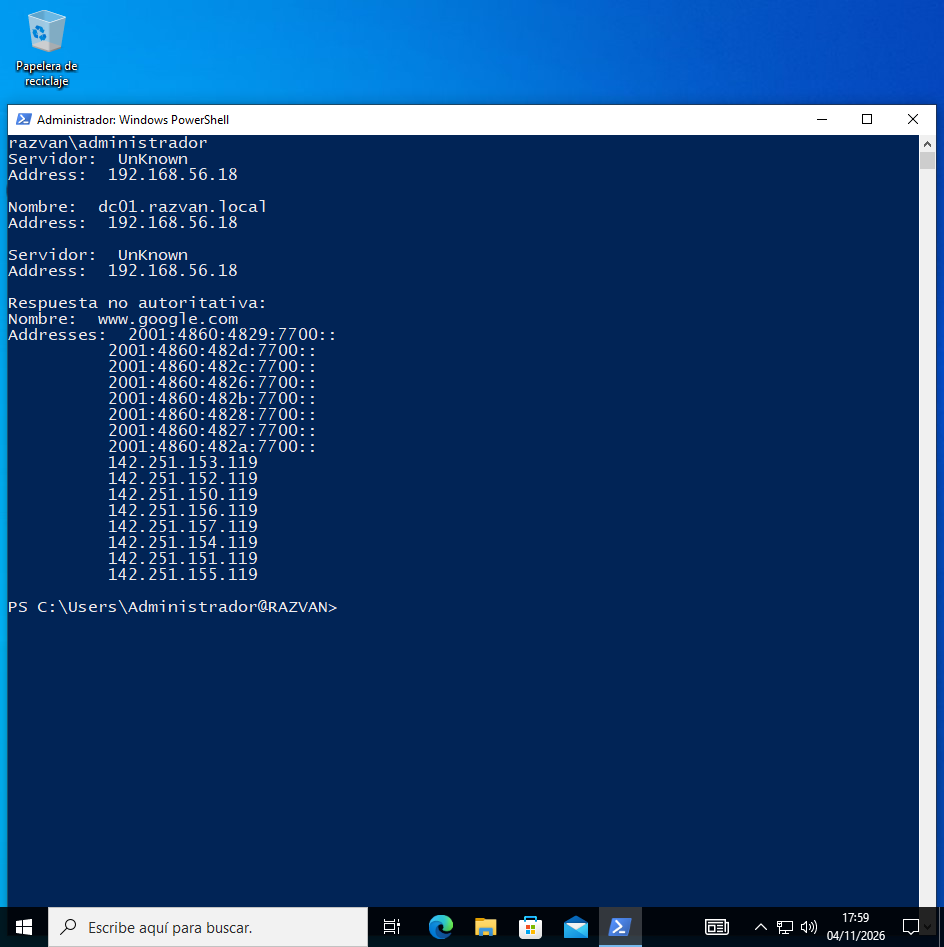

L'usuari és `razvan\administrador`. El primer `nslookup` troba el controlador de domini a `192.168.56.18`, i el segon resol `www.google.com`, així que els reenviadors funcionen.

Al servidor obrim l'**Administrador de DNS** (`dnsmgmt.msc`) i anem a **DC01 › Zonas de búsqueda directa › razvan.local**. A la zona hi ha el registre `dc01` (i, més endavant, `control`) que apunta a `192.168.56.18`.

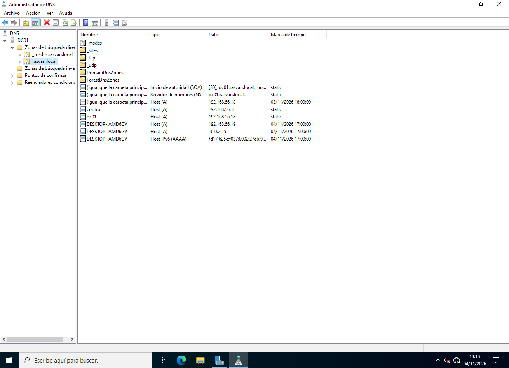

A les propietats de **DC01**, pestanya **Reenviadores**, hi ha les dues adreces: `10.0.2.3` (el DNS de la xarxa NAT de VirtualBox) i `8.8.8.8`. El DNS del domini respon el que és seu i pregunta a fora tota la resta.

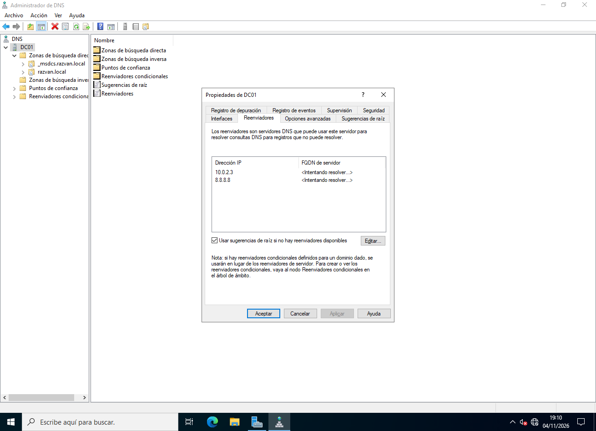

---

### Pas 2: Instal·lem AD CS i creem RAZVAN-CA (Nivell 1)

Al servidor instal·lem el rol **Servicios de certificados de Active Directory** i el configurem com a **CA empresarial arrel** anomenada `RAZVAN-CA`, amb una validesa de 5 anys.

```powershell
Install-WindowsFeature ADCS-Cert-Authority -IncludeManagementTools
Install-AdcsCertificationAuthority -CAType EnterpriseRootCA -CACommonName "RAZVAN-CA" -ValidityPeriod Years -ValidityPeriodUnits 5
```

Obrim la consola de la CA amb `certsrv.msc`.

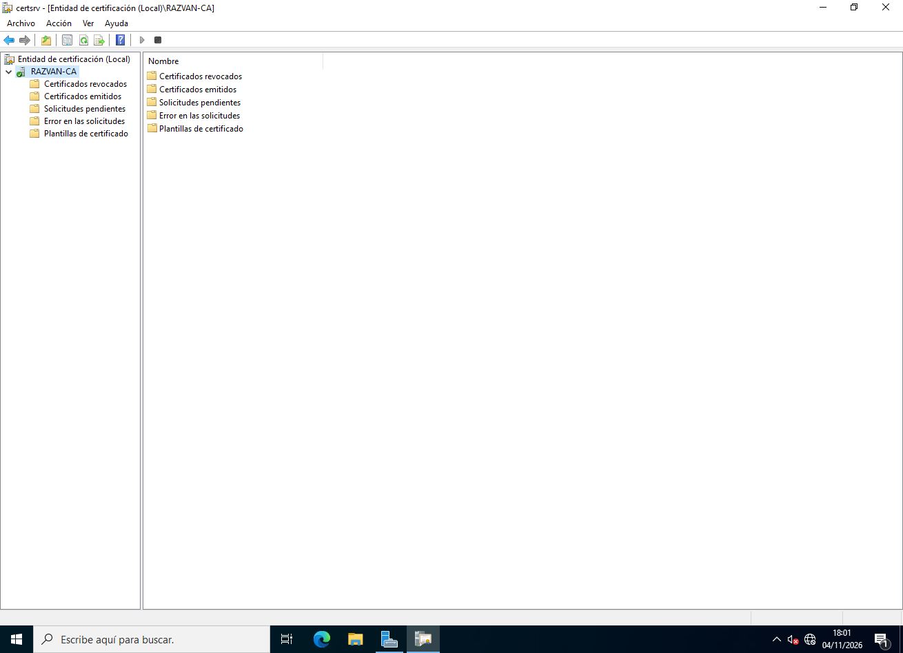

A l'esquerra surt **RAZVAN-CA** amb el senyal verd, i a dins les carpetes de certificats revocats, emesos, sol·licituds i plantilles.

A les propietats de RAZVAN-CA, **Ver certificado › Ruta de certificación**, veiem que la ruta només té un nivell: és la CA arrel i se signa ella mateixa.

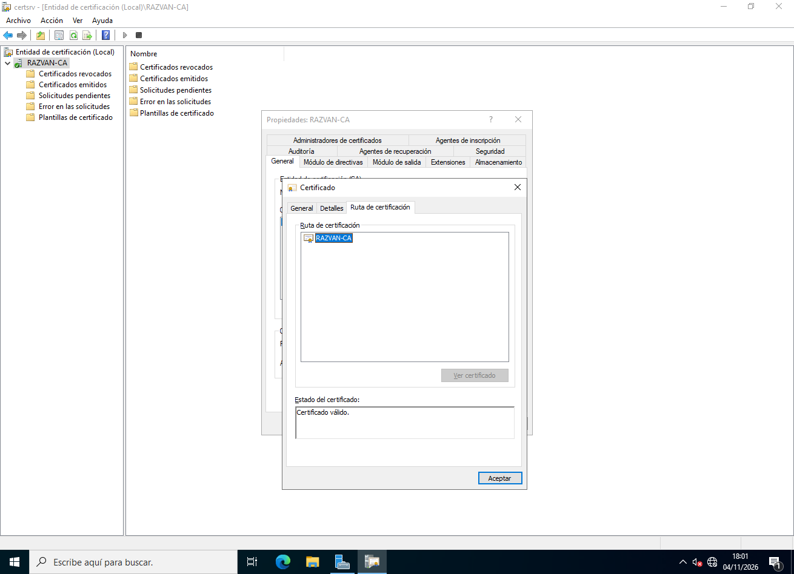

---

### Pas 3: El client ja confia en RAZVAN-CA

Al client forcem les directives del domini i busquem RAZVAN-CA entre les entitats arrel de confiança.

```powershell
gpupdate /force
Get-ChildItem Cert:\LocalMachine\Root | Where-Object Subject -like "*RAZVAN*" | Format-List Subject, Issuer, NotAfter
```

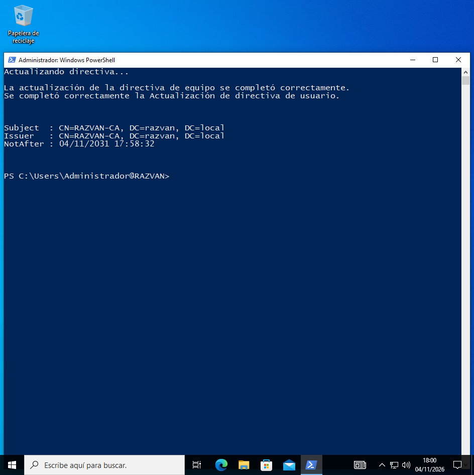

El subjecte i l'emissor són el mateix (`CN=RAZVAN-CA, DC=razvan, DC=local`) perquè és l'arrel, i caduca d'aquí a 5 anys.

També ho comprovem a la consola `certlm.msc`, a **Entidades de certificación raíz de confianza › Certificados**.

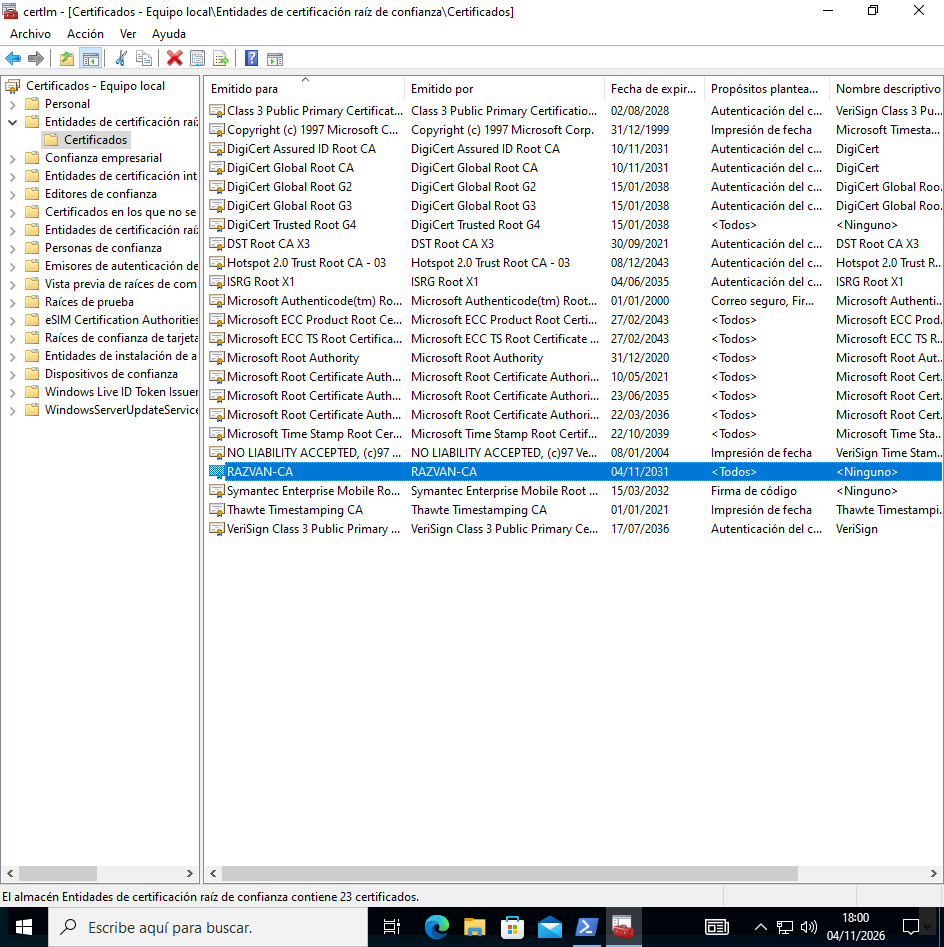

Ningú ha instal·lat RAZVAN-CA a mà al client: ha arribat sola des d'Active Directory. Per això, tot el que signi RAZVAN-CA serà de confiança dins del domini.

---

### Pas 4: Publiquem la web del centre de control (Nivell 2)

Al DNS del servidor creem el registre `control` (tipus A) que apunta a `192.168.56.18`, instal·lem IIS i hi posem la web.

```powershell
Add-DnsServerResourceRecordA -ZoneName razvan.local -Name control -IPv4Address 192.168.56.18
Install-WindowsFeature Web-Server -IncludeManagementTools
```

La pàgina `C:\inetpub\wwwroot\index.html` mostra el **Centre de control RAZVAN**.

Al client obrim Edge i anem a `http://control.razvan.local`.

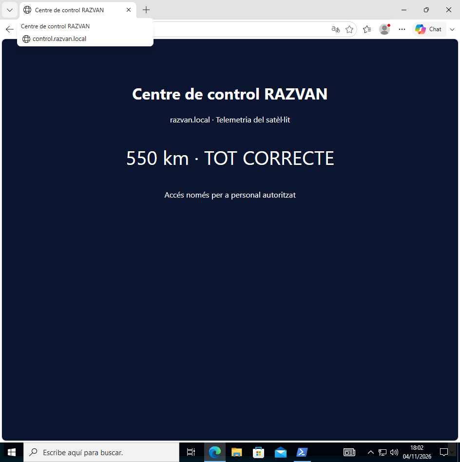

La web funciona, però a l'esquerra de l'adreça surt **No seguro**: tot viatja en clar per la xarxa.

Si l'obrim també amb `http://192.168.56.18` i `http://dc01.razvan.local`, surt la mateixa web: són tres noms per al mateix servidor.

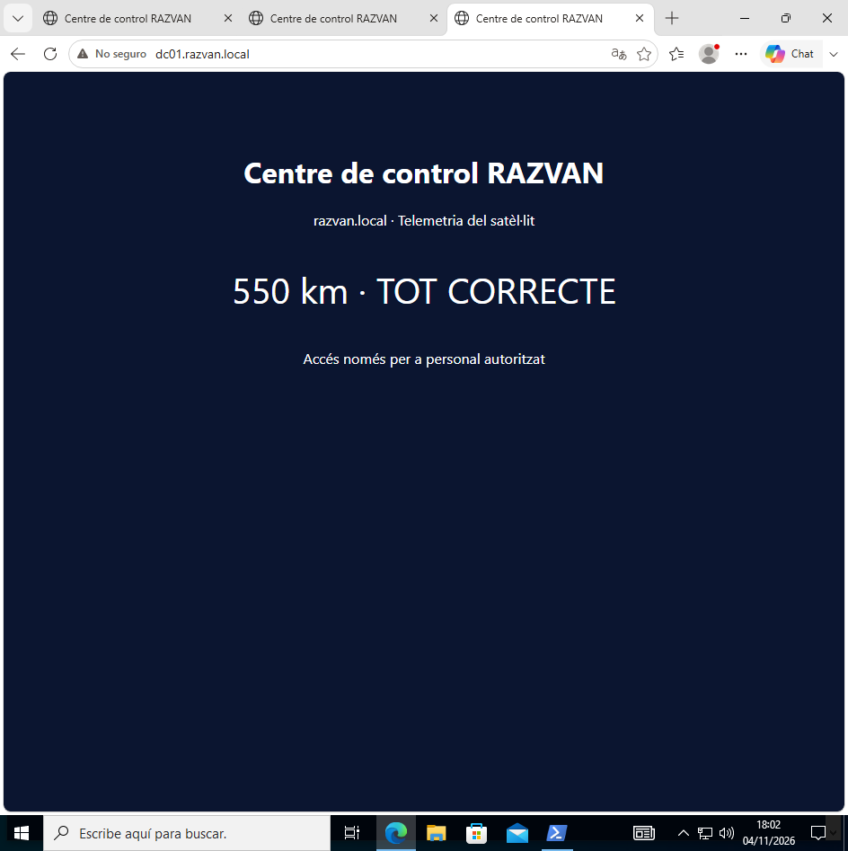

---

### Pas 5: El cadenat de pega (Nivell 3)

Al servidor fabriquem un certificat autosignat per a `control.razvan.local` i l'afegim a IIS amb un enllaç `https` pel port 443.

```powershell
New-SelfSignedCertificate -DnsName control.razvan.local -CertStoreLocation Cert:\LocalMachine\My -FriendlyName "Cadenat de pega"
```

Al client obrim una finestra **InPrivate** d'Edge i anem a `https://control.razvan.local`.

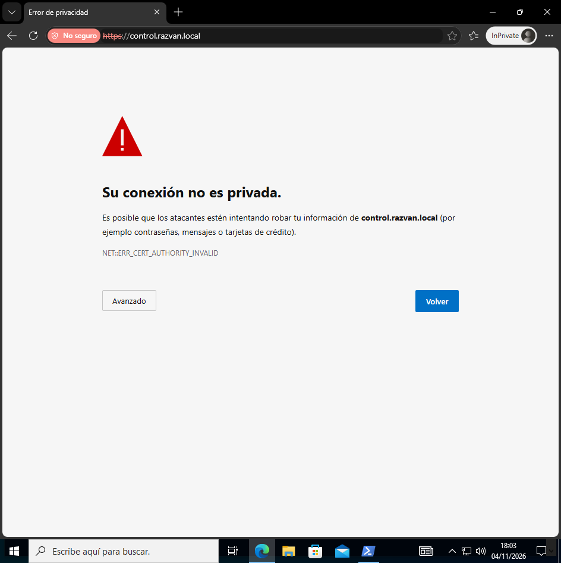

Edge no mostra la web i dona l'error **`NET::ERR_CERT_AUTHORITY_INVALID`**: el certificat l'ha signat una autoritat en què no confia (ell mateix).

Per veure-ho encara més clar, fabriquem un certificat fals per a `www.google.com` i llistem els certificats de l'equip.

```powershell
New-SelfSignedCertificate -DnsName www.google.com -CertStoreLocation Cert:\LocalMachine\My -FriendlyName "Google de mentida"
Get-ChildItem Cert:\LocalMachine\My | Format-Table FriendlyName, Subject, Issuer -AutoSize
```

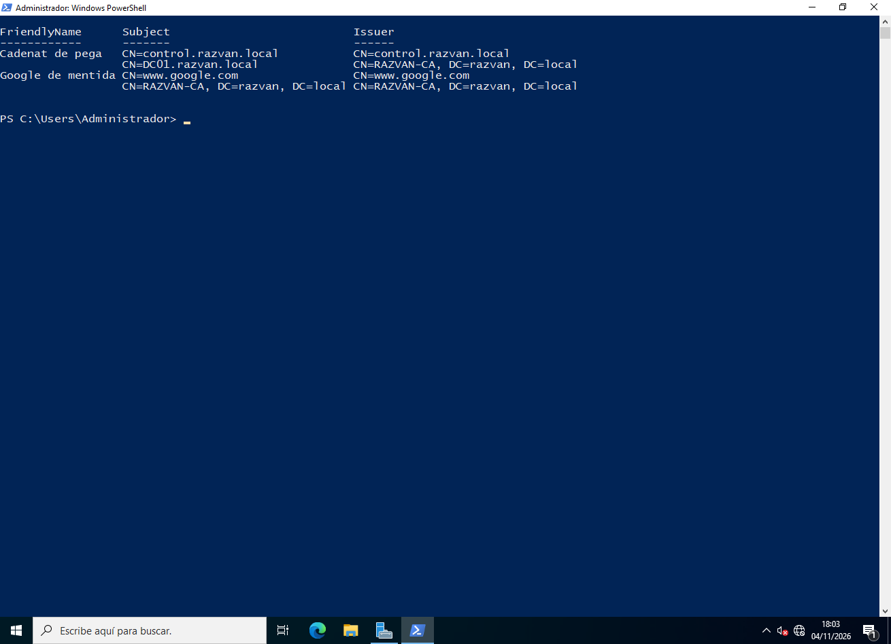

Als certificats autosignats el subjecte i l'emissor són el mateix. Qualsevol pot fabricar-ne un amb qualsevol nom, i per això no serveixen. Després l'esborrem.

---

### Pas 6: Creem la plantilla WebServer-SAN (Nivell 4)

Obrim la **Consola de plantillas de certificado** (`certtmpl.msc`) i dupliquem la plantilla **Servidor web** com a **WebServer-SAN**. A les propietats de la plantilla nova revisem cada pestanya.

A **General**, el nom és `WebServer-SAN`, el **Período de validez** és de **2 años** i *Publicar certificado en Active Directory* queda desmarcat.

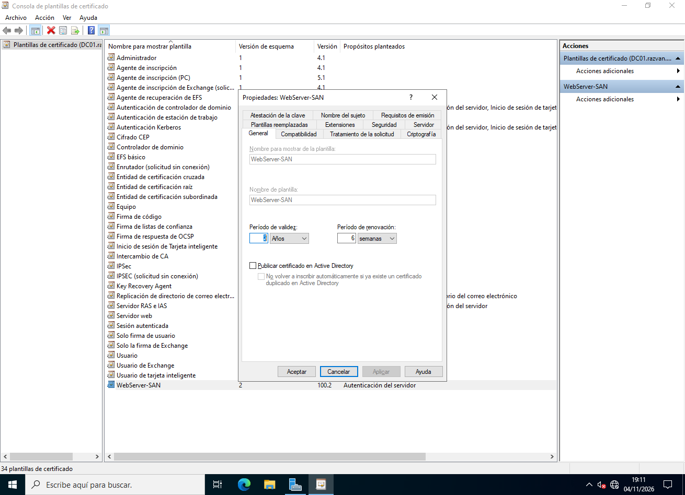

A **Compatibilidad**, l'entitat de certificació és **Windows Server 2016** i el destinatari **Windows 10/Windows Server 2016**.

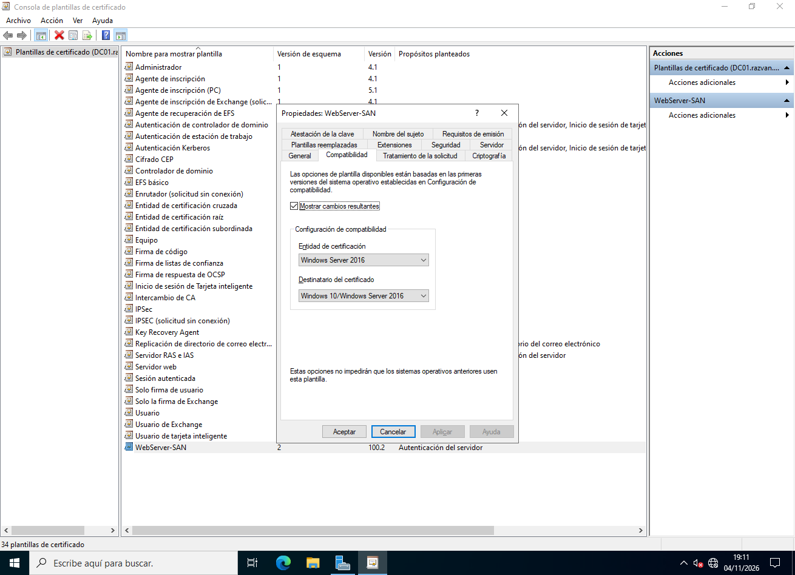

A **Nombre del sujeto** està marcat **Proporcionado por el solicitante**: el nom l'escriurem nosaltres a la sol·licitud.

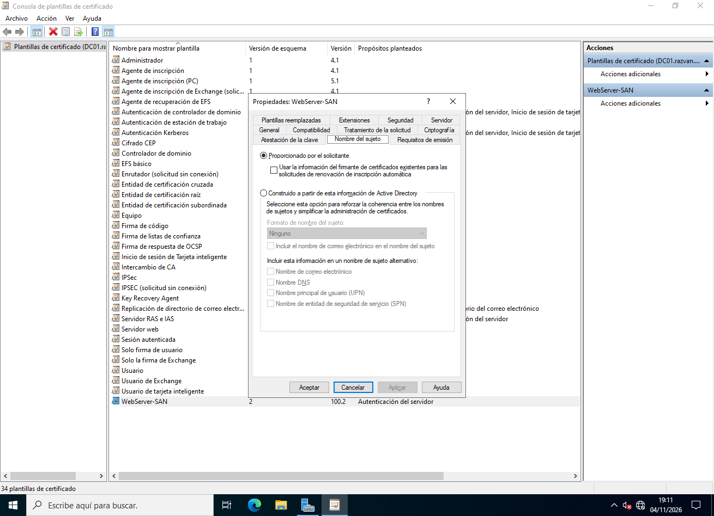

A **Seguridad**, **Equipos del dominio** té permís de **Leer** i **Inscribirse**, i **Admins. del dominio** també pot inscriure's. Així qualsevol servidor del domini, i nosaltres com a `Administrador`, podem demanar certificats web amb aquesta plantilla.

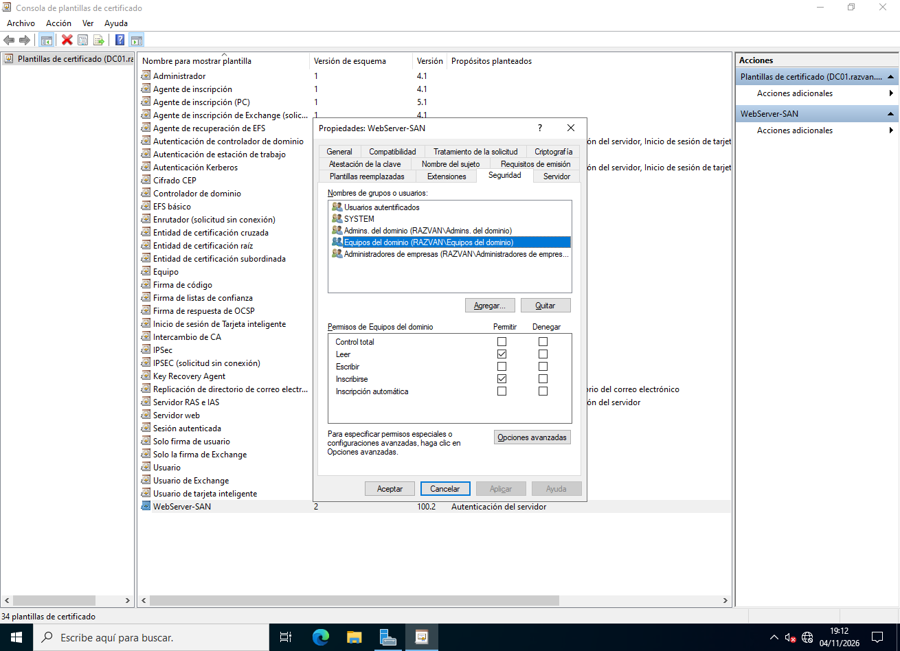

A **Extensiones › Directivas de aplicación** surt l'ús **Autenticación del servidor**: el certificat serveix per identificar un servidor, no per signar scripts.

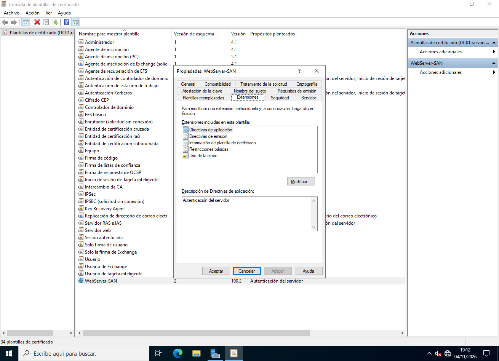

Després la publiquem a RAZVAN-CA (**Plantillas de certificado › Nuevo › Plantilla de certificado para emitir**, o per PowerShell) perquè la pugui fer servir.

```powershell
certutil -SetCATemplates +WebServer-SAN
```

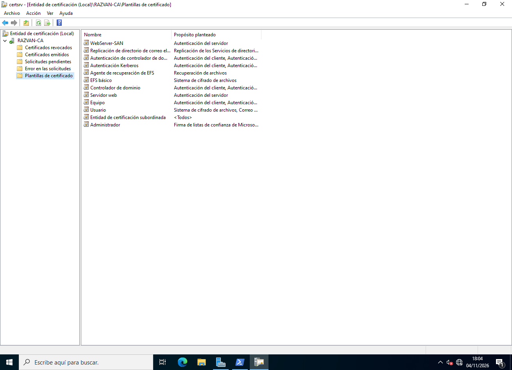

A **Plantillas de certificado** de `certsrv.msc` ja surt **WebServer-SAN**, amb el propòsit **Autenticación del servidor**: el certificat serveix per identificar un servidor, no per signar scripts.

---

### Pas 7: Demanem el certificat oficial (Nivell 5)

Al servidor creem la carpeta `C:\certs` i el fitxer `web.inf` amb la recepta del certificat.

```ini
[Version]
Signature="$Windows NT$"

[NewRequest]
Subject = "CN=control.razvan.local"
FriendlyName = "Cadenat oficial"
KeyLength = 2048
KeySpec = 1
KeyUsage = 0xa0
MachineKeySet = TRUE
SMIME = FALSE
PrivateKeyArchive = FALSE
UserProtected = FALSE
UseExistingKeySet = FALSE
ProviderName = "Microsoft RSA SChannel Cryptographic Provider"
RequestType = PKCS10
KeyAlgorithm = RSA

[Extensions]
2.5.29.17 = "{text}"
_continue_ = "dns=control.razvan.local"

[RequestAttributes]
CertificateTemplate = WebServer-SAN
```

Creem la sol·licitud, l'enviem a RAZVAN-CA i instal·lem el certificat que ens retorna.

```powershell
cd C:\certs
certreq -new web.inf web.req
certreq -submit -config "DC01.razvan.local\RAZVAN-CA" web.req web.cer
certreq -accept web.cer
```

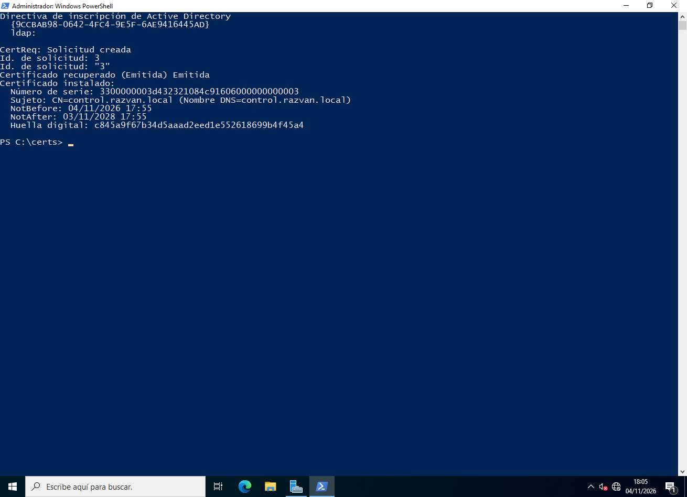

La sol·licitud surt com a **Emitida** i el certificat queda instal·lat, amb el nom DNS `control.razvan.local` i validesa de 2 anys.

Comparem els dos certificats de la web.

```powershell
Get-ChildItem Cert:\LocalMachine\My | Where-Object Subject -eq "CN=control.razvan.local" | Format-List FriendlyName, Subject, Issuer, DnsNameList, NotAfter
```

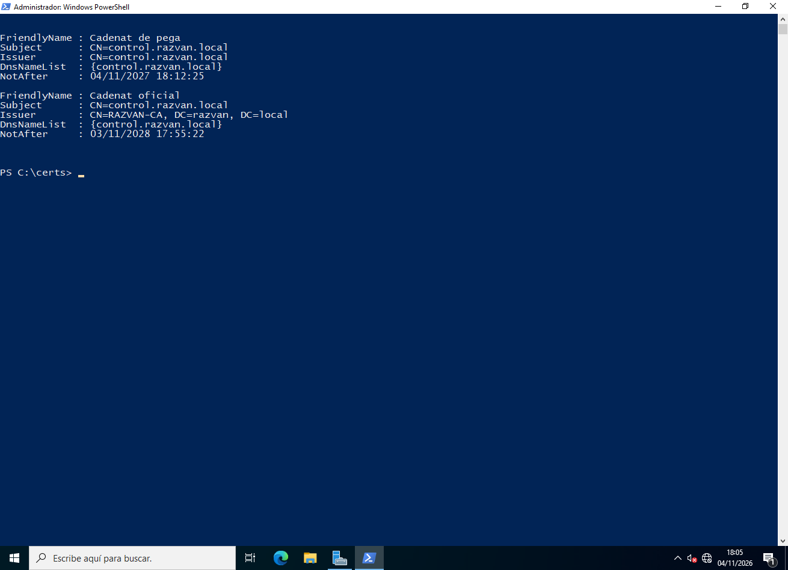

Tenen el mateix nom i el mateix SAN. L'única diferència és l'**emissor**: el de pega se signa ell mateix i l'oficial l'ha signat **RAZVAN-CA**.

A `certsrv.msc`, a **Certificados emitidos**, surt la sol·licitud 3, demanada per `RAZVAN\Administrador` amb la plantilla **WebServer-SAN**.

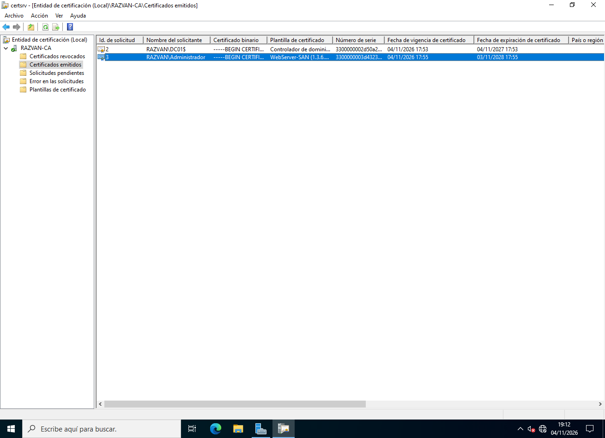

L'obrim amb doble clic i, a la pestanya **Detalles**, el camp **Nombre alternativo del titular** (el SAN) conté `Nombre DNS=control.razvan.local`.

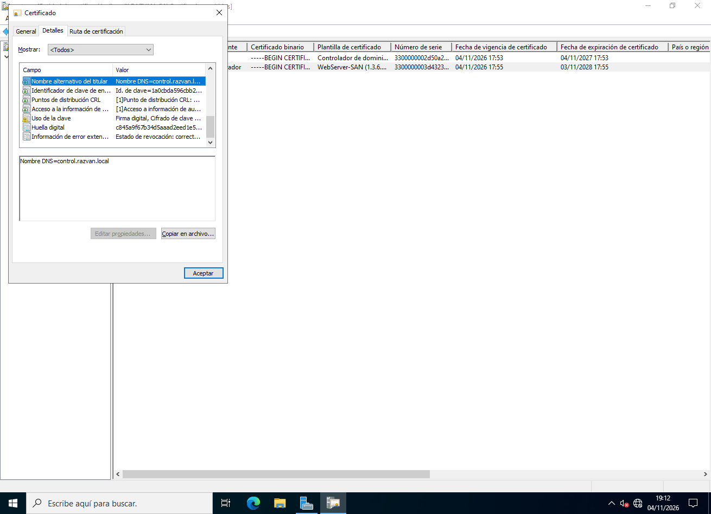

---

### Pas 8: El cadenat oficial (Nivell 6)

A IIS canviem el certificat de l'enllaç `https` del **Default Web Site** pel **Cadenat oficial**.

Al client obrim una finestra InPrivate d'Edge i tornem a `https://control.razvan.local`.

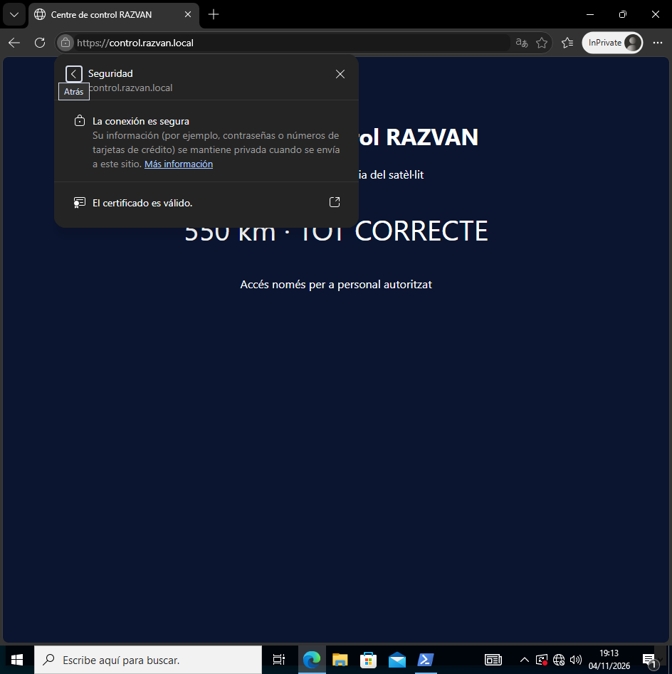

Ara la web surt a la primera, sense cap avís. En clicar el cadenat i després **La conexión es segura**, Edge diu **El certificado es válido**.

Obrim el certificat des d'aquí. Al **Visor de certificados** d'Edge veiem que està emès per a `control.razvan.local` i que l'emissor és **RAZVAN-CA**.

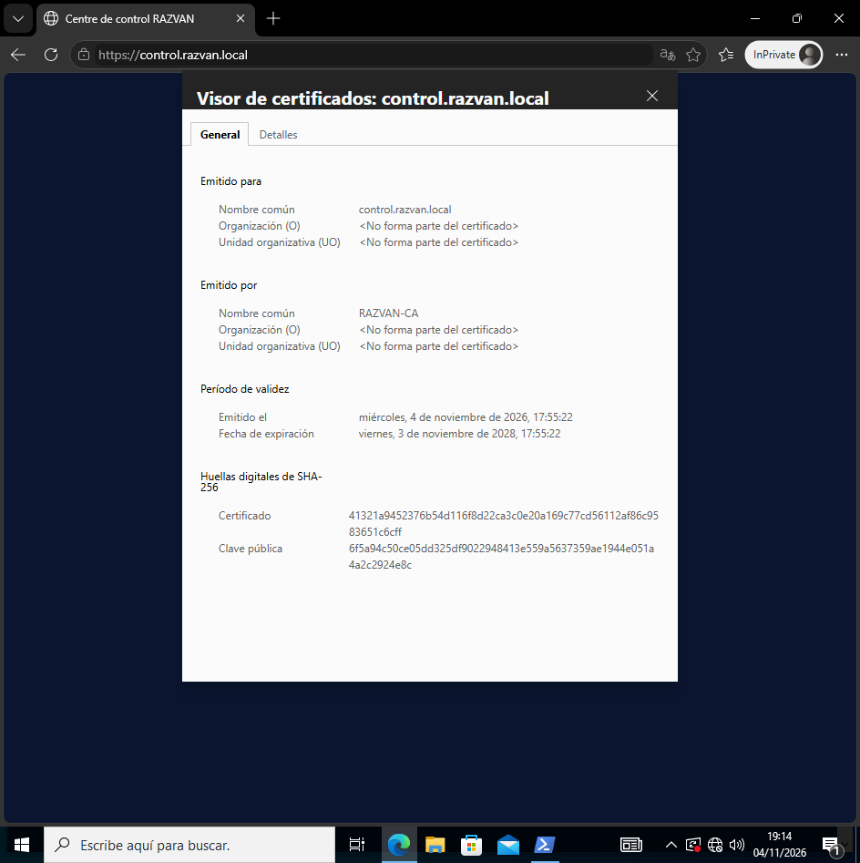

A la pestanya **Detalles**, a dalt hi ha la **Jerarquía de certificados**: **RAZVAN-CA** a dalt i **control.razvan.local** a sota. És la cadena de confiança de la teoria.

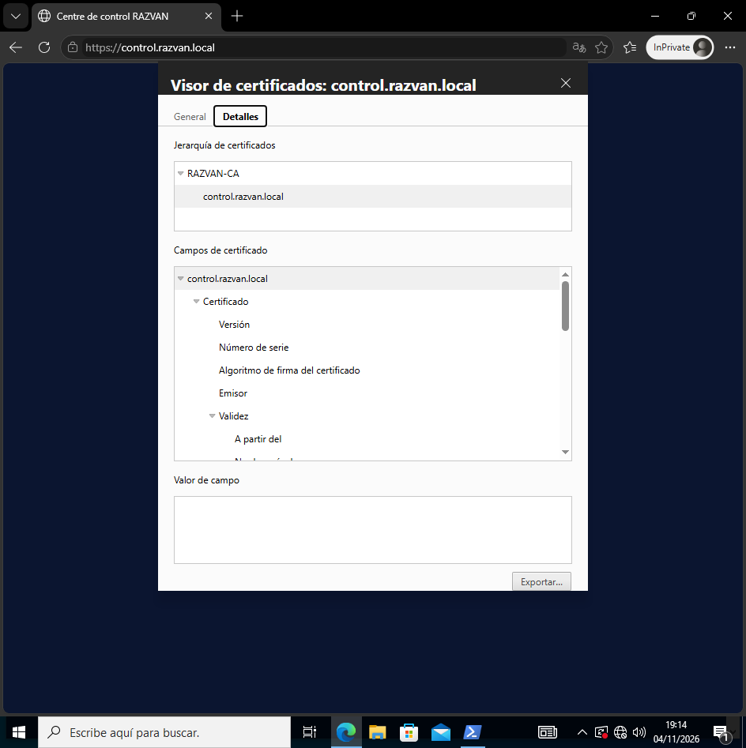

Edge mostra el cadenat perquè es compleixen quatre coses alhora:
1. El certificat l'ha signat RAZVAN-CA.
2. RAZVAN-CA és a la llista de confiança del client (pas 3).
3. El nom de l'adreça, `control.razvan.local`, surt al SAN.
4. El certificat no ha caducat ni està revocat.

Per últim, en una finestra InPrivate obrim els altres dos noms del servidor: `https://192.168.56.18` i `https://dc01.razvan.local`.


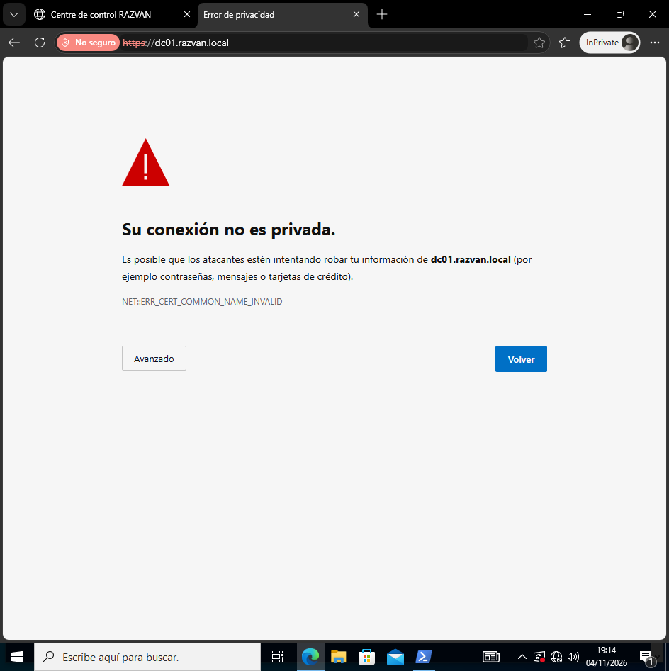

En tots dos surt l'error **`NET::ERR_CERT_COMMON_NAME_INVALID`**. El certificat és oficial, però ni la IP ni `dc01.razvan.local` surten al SAN (falla la condició 3). Per acceptar més noms, al `web.inf` es poden posar separats amb `&`, per exemple `"dns=control.razvan.local&dns=dc01.razvan.local"`.

Al final fem una instantània de les dues màquines amb el nom **Web amb HTTPS**.
