## 8. Activitat Pràctica (3a part): La VPN de l'oficina

### 🎯 Objectiu de l'activitat
1. Afegir un tercer servidor, **VPN-RAZVAN**, amb una targeta a l'oficina i una altra a «Internet».
2. Donar-li un certificat **vpn.razvan.local** emès per RAZVAN-CA amb la plantilla **WebServer-SAN**.
3. Configurar una VPN **SSTP** amb *Enrutamiento y acceso remoto* i donar permís només a la Lia.
4. Portar el client a «casa» i entrar a la web del centre de control a través del túnel.

| Màquina | Paper | Adreces |
|---------|-------|---------|
| `DC01` | Controlador de domini, DNS i RAZVAN-CA | `192.168.56.18` |
| `VPN-RAZVAN` | Servidor VPN | Interna `192.168.56.10` · Externa `203.0.113.1` |
| Client Windows 10 | Ordinador de la Lia | Oficina per DHCP · «A casa» `203.0.113.50` |

La xarxa de l'oficina és la xarxa *només amfitrió* de VirtualBox (`192.168.56.0/24`) i «Internet» és una **xarxa interna** de VirtualBox anomenada `Internet` (`203.0.113.0/24`). Abans de començar fem una instantània del servidor i del client (**Abans VPN**).

---

### Pas 20: La porta del darrere (Nivell 10)

Creem la màquina **VPN-RAZVAN** a partir de l'OVA de Windows Server 2022. Com que és una còpia, abans d'unir-la al domini la generalitzem amb `sysprep /generalize`, perquè tingui un SID nou i no xoqui amb el del controlador de domini.

Li posem dues targetes. La primera la renombrem **Interna** i va a l'oficina, amb l'adreça fixa `192.168.56.10` i el DNS del controlador de domini (`192.168.56.18`).

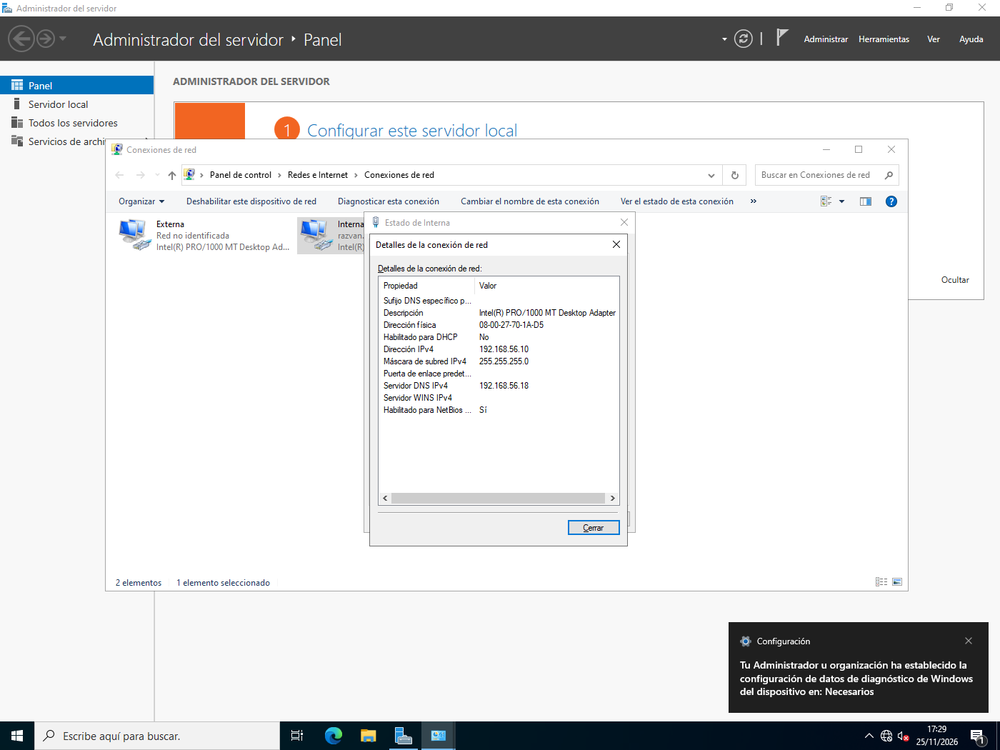

La segona la renombrem **Externa** i va connectada a la xarxa `Internet` amb l'adreça `203.0.113.1/24`, **sense porta d'enllaç i sense DNS**. Si li poséssim DNS, el servidor intentaria preguntar a Internet pels noms del domini.

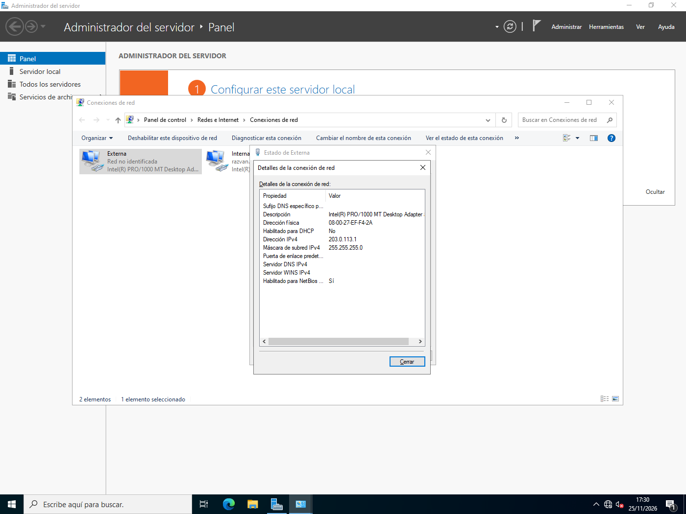

Després la unim al domini `razvan.local` i reiniciem. Per comprovar que està dins del domini, obrim `\\dc01.razvan.local` a l'explorador i veiem les carpetes compartides **NETLOGON** i **SYSVOL**.

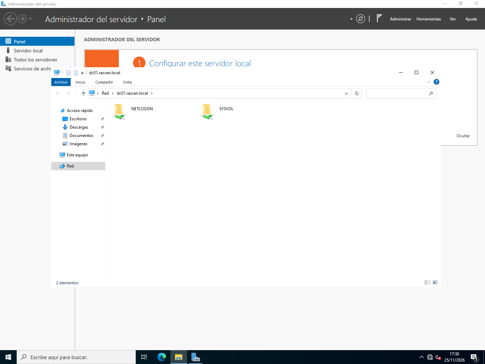

#### Repte 10
A la consola **DNS** del controlador de domini, la zona `razvan.local` té el registre **VPN-RAZVAN** apuntant només a `192.168.56.10`. No hi ha cap registre amb `203.0.113.1`, perquè la targeta externa no es registra al DNS. Si hi fos, els equips de l'oficina podrien intentar arribar a la VPN per una adreça que no poden fer servir.

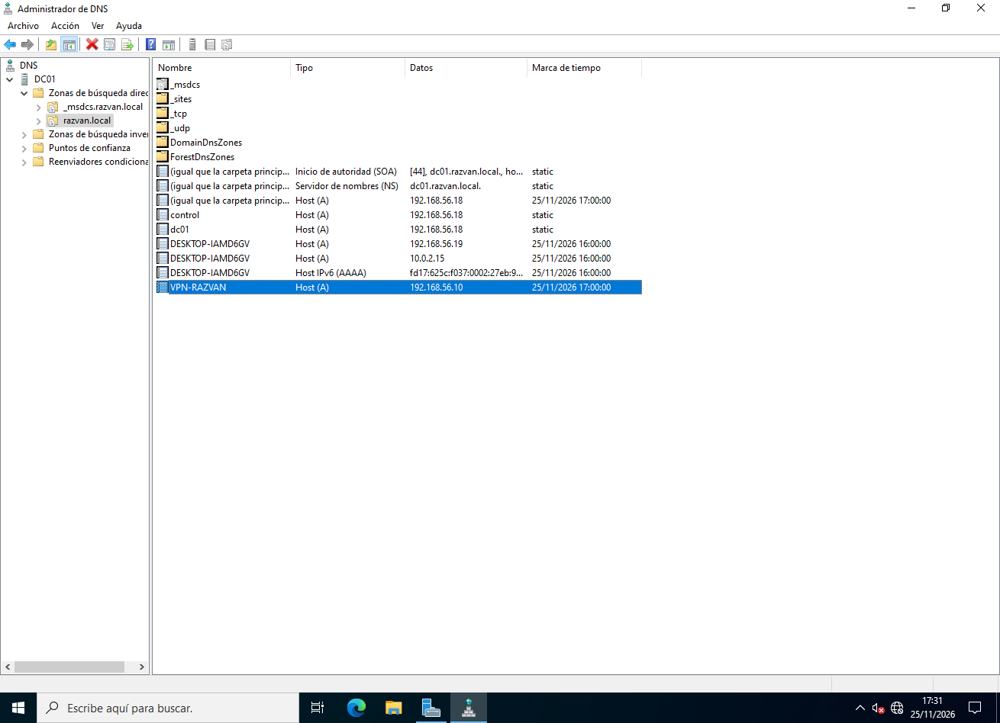

---

### Pas 21: El certificat de la porta (Nivell 11)

A VPN-RAZVAN obrim `certlm.msc` (**Certificados - Equipo local**), perquè el certificat és de l'equip i no d'un usuari. A **Personal › Todas las tareas › Solicitar un nuevo certificado...** triem la plantilla **WebServer-SAN** que vam crear a la 1a part i omplim:

| Camp | Valor |
|------|-------|
| Nombre común | `vpn.razvan.local` |
| Nombre alternativo (DNS) | `vpn.razvan.local` |
| Nombre descriptivo | `Porta VPN` |

A **Personal › Certificados** hi ha el certificat **vpn.razvan.local**, emès per **RAZVAN-CA**, amb el propòsit **Autenticación del servidor** i la plantilla **WebServer-SAN**.

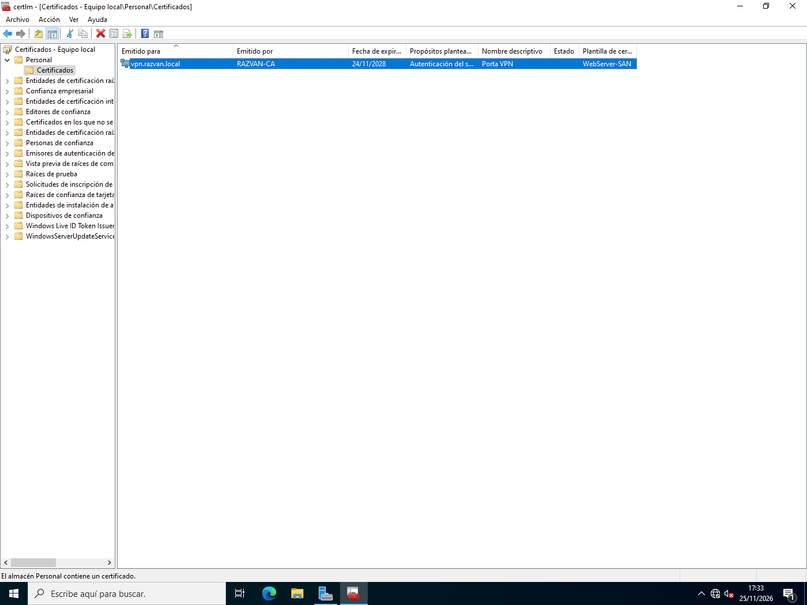

A la pestanya **Detalles**, el camp **Nombre alternativo del titular** diu `Nombre DNS=vpn.razvan.local`. És el nom amb què el client es connectarà i és el que comprovarà.

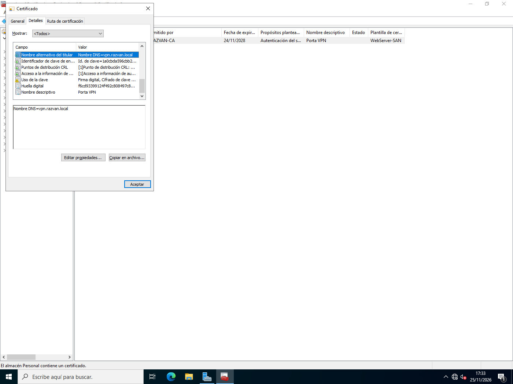

#### Repte 11
Al controlador de domini, a `certsrv.msc › Certificados emitidos`, es veuen els dos certificats fets amb la plantilla **WebServer-SAN**: el de la web del centre de control de la 1a part i el de `VPN-RAZVAN`. La mateixa plantilla serveix per a qualsevol servidor que necessiti un certificat amb nom alternatiu, i no cal fer-ne una de nova per a cada màquina.

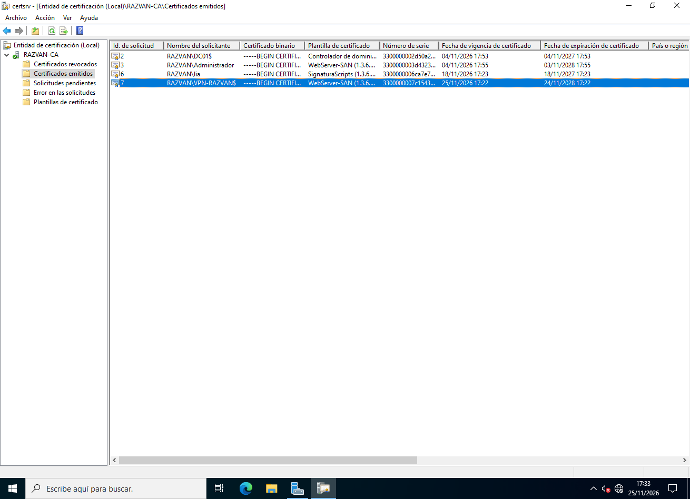

---

### Pas 22: Obrir la porta (Nivell 12)

A VPN-RAZVAN instal·lem el rol **Acceso remoto** amb el servei **DirectAccess y VPN (RAS)**. Després obrim **Enrutamiento y acceso remoto**, fem **Configurar y habilitar Enrutamiento y acceso remoto** i triem **Configuración personalizada › Acceso VPN**. Ho hem fet amb PowerShell, que fa el mateix:

```powershell
Install-WindowsFeature RemoteAccess, DirectAccess-VPN -IncludeManagementTools
Install-RemoteAccess -VpnType Vpn -Legacy
Set-VpnIPAddressAssignment -IPAddressRange "192.168.56.200","192.168.56.220" -Type StaticPool
Set-RemoteAccess -SslCertificate (Get-ChildItem Cert:\LocalMachine\My | ? Subject -eq "CN=vpn.razvan.local")
```

Les adreces del grup estàtic (`192.168.56.200` a `.220`) són de l'oficina però estan fora del rang de DHCP de la xarxa (`.3` a `.199`), perquè no es trepitgin.

A les **Propiedades** del servidor, pestanya **Seguridad**, l'autenticació és **Autenticación de Windows** (els usuaris d'Active Directory) i, a **Enlace de certificado SSL**, el certificat és **vpn.razvan.local**. És el certificat que ensenyarà el servidor quan algú s'hi connecti per SSTP (HTTPS pel port 443).

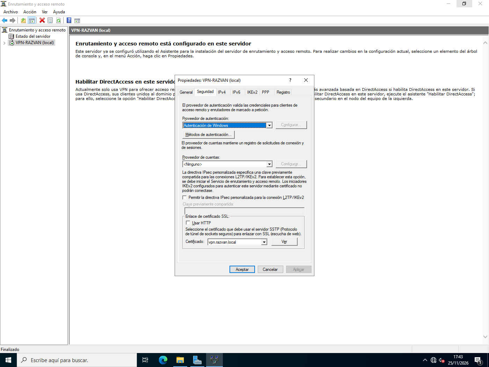

A la pestanya **IPv4** hi ha el **Conjunto de direcciones estáticas** i, a baix, triem l'**Adaptador** **Interna**. Així els clients de la VPN reben el DNS de l'oficina.

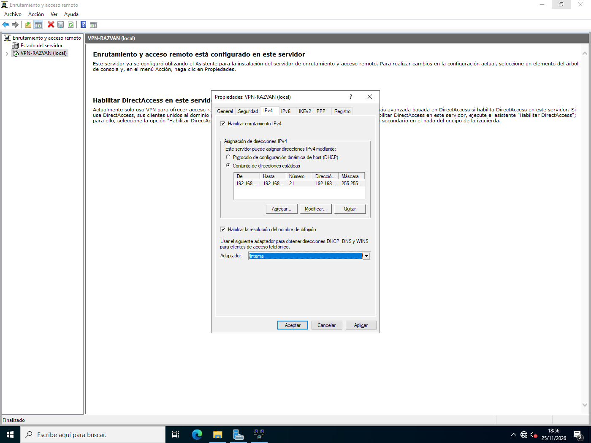

Ara VPN-RAZVAN surt **en verd** a la consola: el servei està en marxa.

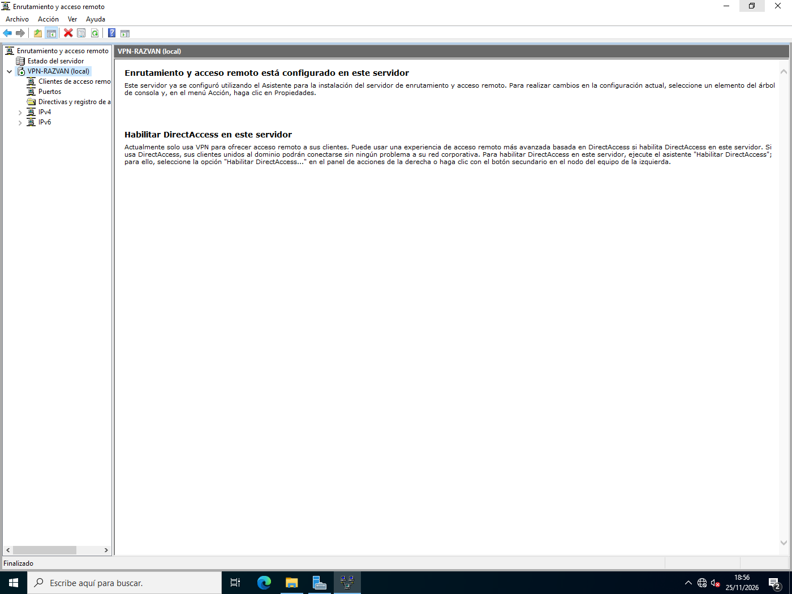

Al controlador de domini donem permís a la Lia. A **Usuarios y equipos de Active Directory**, a les propietats de **Lia Ferré**, pestanya **Marcado**, marquem **Permitir acceso**. En Teo es queda amb **Controlar acceso a través de la directiva de red NPS**, que per defecte vol dir que no pot entrar.

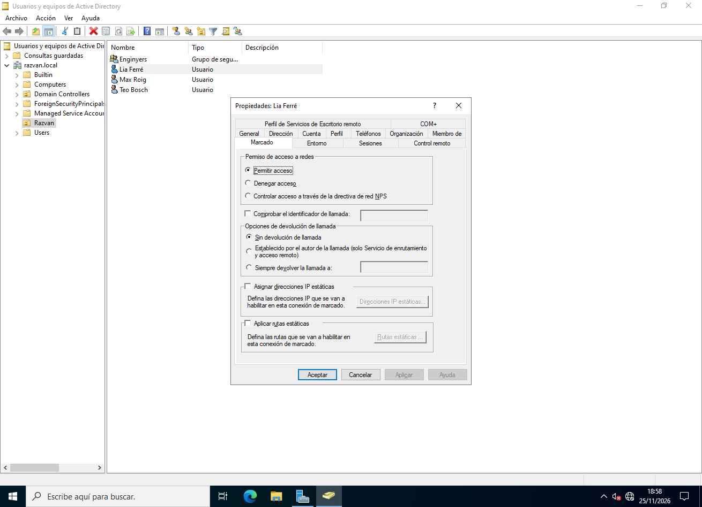

Perquè VPN-RAZVAN pugui llegir aquest permís ha de ser al grup **Builtin › Servidores RAS e IAS**. Hi és, i ho comprovem per PowerShell:

```powershell
Get-ADGroupMember "Servidores RAS e IAS" | Select-Object name
# name
# ----
# VPN-RAZVAN
```

#### Repte 12
A **Puertos** hi ha la llista de ports de VPN-RAZVAN. Cada port és una connexió que pot estar oberta alhora. Es veuen els ports **WAN Miniport (SSTP)**, i més avall hi ha els d'**IKEv2**, **L2TP** i **PPTP**. A Windows Server 2022 PPTP i L2TP encara hi són, tot i que PPTP és insegur i no l'hauríem de fer servir.

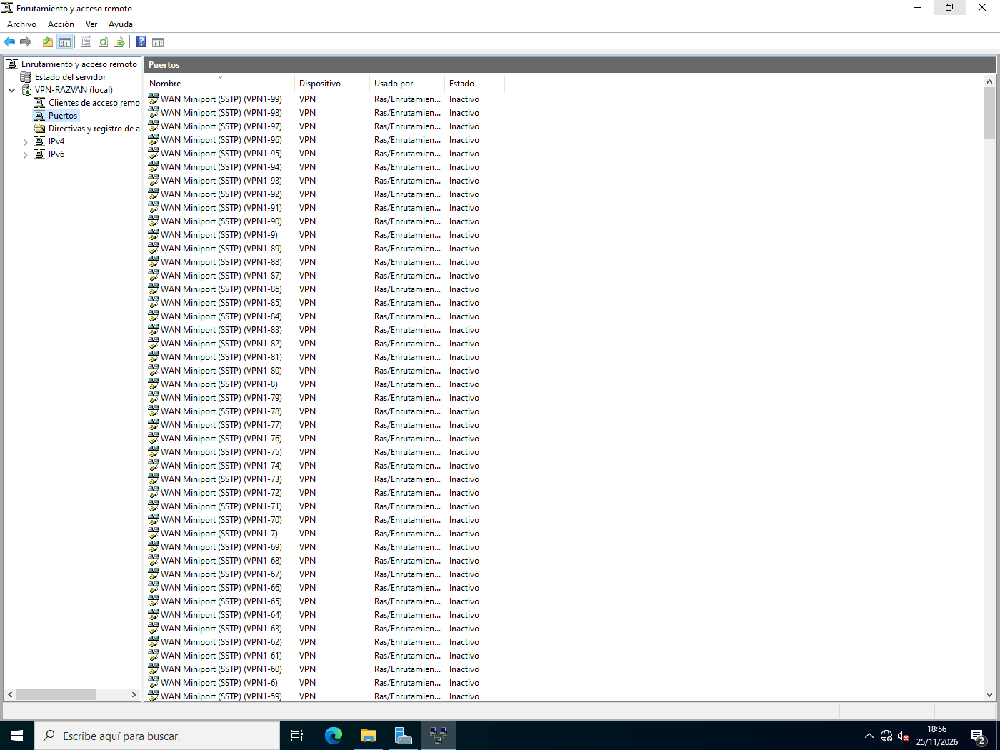

---

### Pas 23: Preparar la motxilla (Nivell 13, part A)

Encara a l'oficina, al client entrem com `RAZVAN\Administrador` i fem dues coses:

1. Afegim aquesta línia al fitxer `C:\Windows\System32\drivers\etc\hosts`. A Internet això ho faria un DNS públic, però al laboratori ho fa el fitxer `hosts`.

   ```
   203.0.113.1     vpn.razvan.local
   ```

2. Creem el valor DWORD `NoCertRevocationCheck = 1` a `HKLM\SYSTEM\CurrentControlSet\Services\SstpSvc\Parameters`. Abans de connectar, el client vol comprovar a la CRL de RAZVAN-CA que el certificat de la VPN no està revocat, però la CRL és a dins de l'oficina i des de casa no hi arriba fins que la VPN està connectada (l'ou i la gallina). Sense aquest valor la connexió falla amb l'error `0x80092013`.

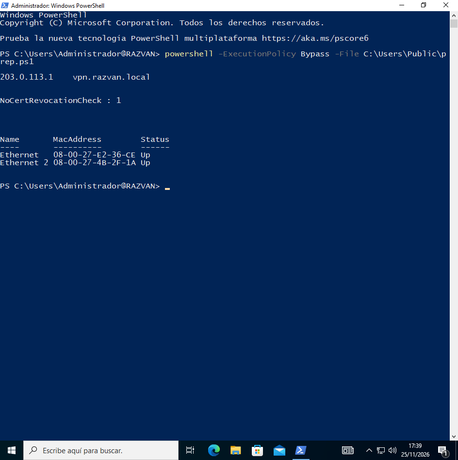

---

### Pas 24: Cap a casa (Nivell 13, part B)

A VirtualBox canviem l'adaptador 1 del client a **Red interna** amb el nom `Internet` i deixem desconnectat l'adaptador de l'oficina. Al client li posem l'adreça `203.0.113.50/24`, sense porta d'enllaç i sense DNS.

Ara el client arriba a l'adreça externa de VPN-RAZVAN (`203.0.113.1`) però **no** al controlador de domini (`192.168.56.18`). Ja és «a casa».

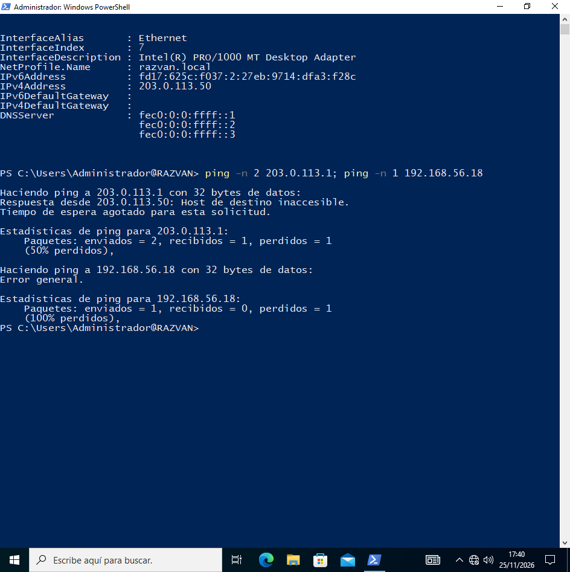

---

### Pas 25: A casa, sense VPN (Nivell 13, part C)

Entrem al client com `RAZVAN\lia`. Windows ens deixa entrar encara que no vegi el controlador de domini, perquè recorda l'última vegada que la Lia va entrar en aquest equip.

A Edge obrim `https://vpn.razvan.local`. La pàgina diu **404 Not Found**, perquè VPN-RAZVAN no és una web, però a l'esquerra de l'adreça hi ha el **cadenat**: arribem al servidor pel port 443 i el seu certificat és bo, signat per RAZVAN-CA i amb el nom correcte.

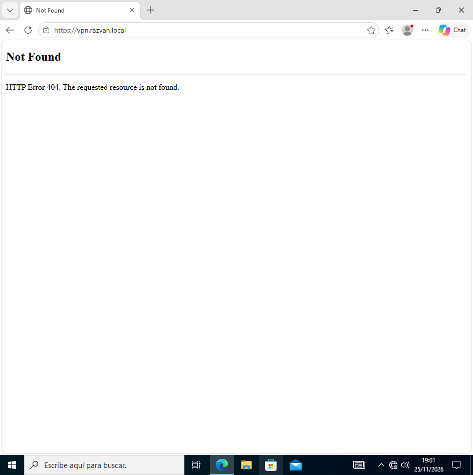

En canvi, `https://control.razvan.local` no funciona. Des de casa el centre de control no existeix.

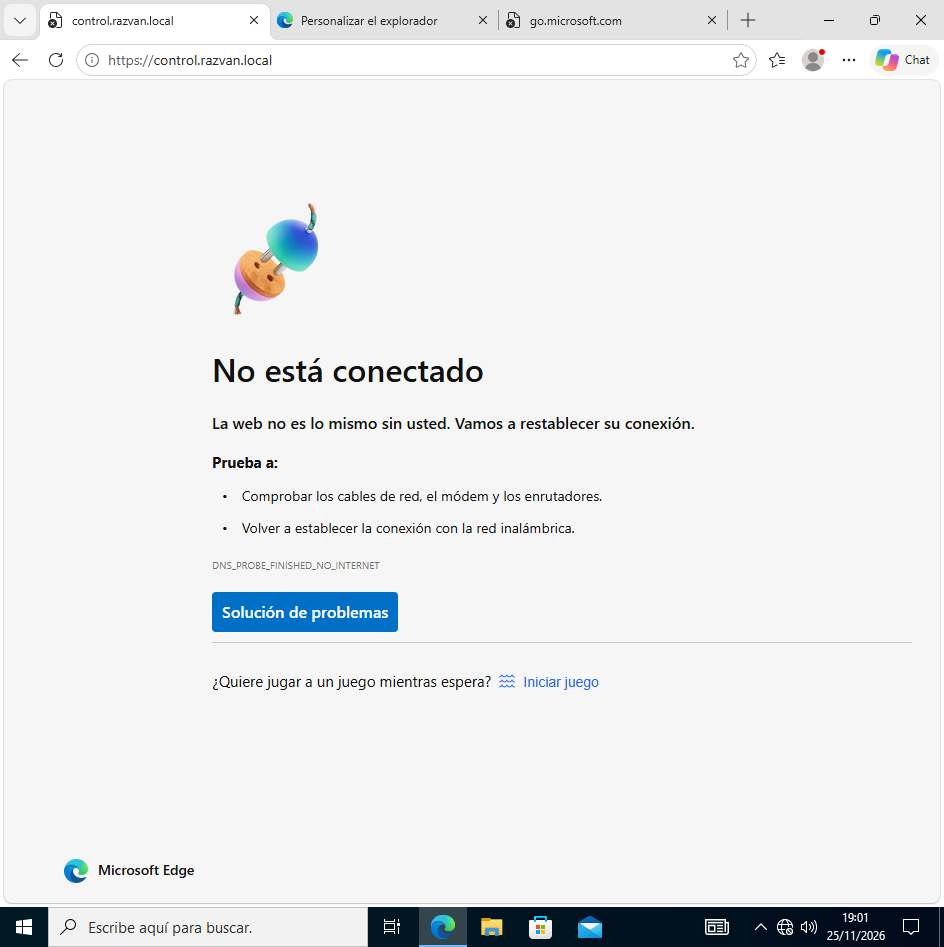

---

### Pas 26: Connectar-se (Nivell 13, part D)

Creem la connexió **VPN Razvan** amb el servidor `vpn.razvan.local` (el nom del certificat), el tipus **SSTP** i usuari i contrasenya. És el mateix que fer-ho a **Configuración › Red e Internet › VPN › Agregar VPN**:

```powershell
Add-VpnConnection -Name "VPN Razvan" -ServerAddress vpn.razvan.local -TunnelType Sstp -AuthenticationMethod MSChapv2 -EncryptionLevel Required -RememberCredential:$false -PassThru
```

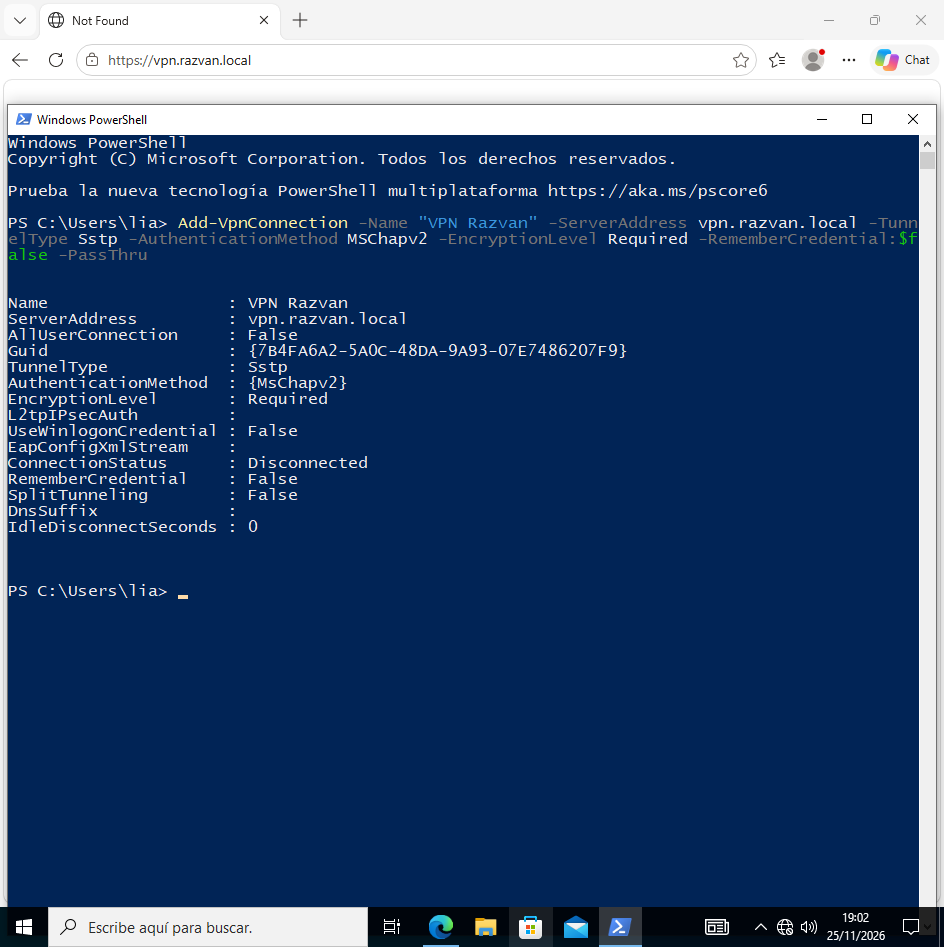

Connectem amb l'usuari `lia`, la contrasenya `Razvan.2026` i el domini `RAZVAN`.

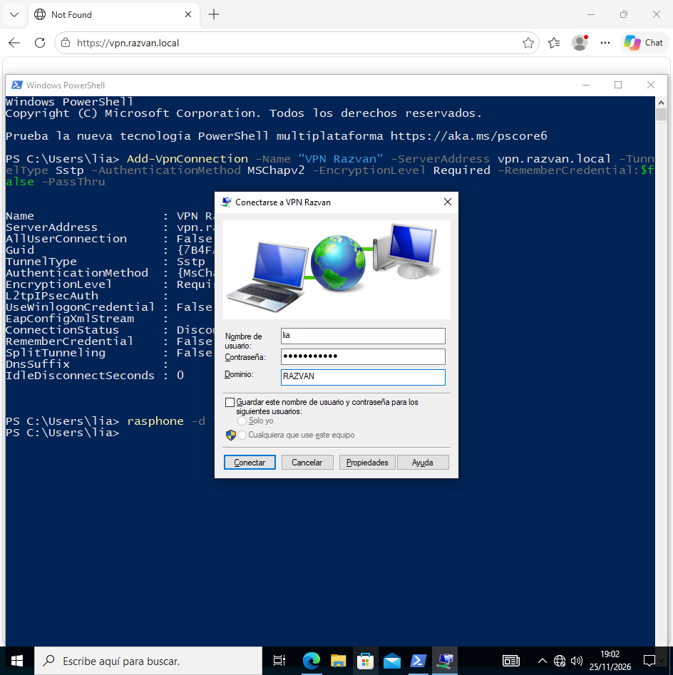

La connexió queda **Connected**. El client té ara dues adreces: la de casa (`203.0.113.50`) a la targeta **Ethernet** i una de l'oficina (`192.168.56.201`) a la connexió **VPN Razvan**, que li ha donat VPN-RAZVAN del seu grup d'adreces.

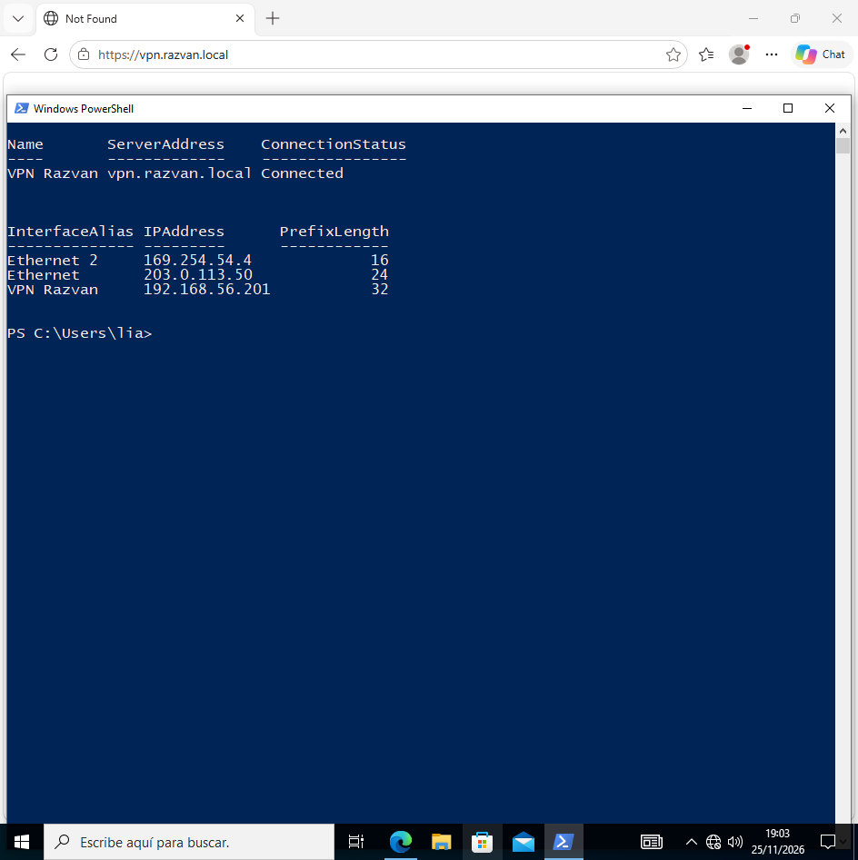

Ara el nom `control.razvan.local` es resol amb el DNS de l'oficina (`192.168.56.18`) i el port 443 respon **a través de la interfície VPN Razvan**.

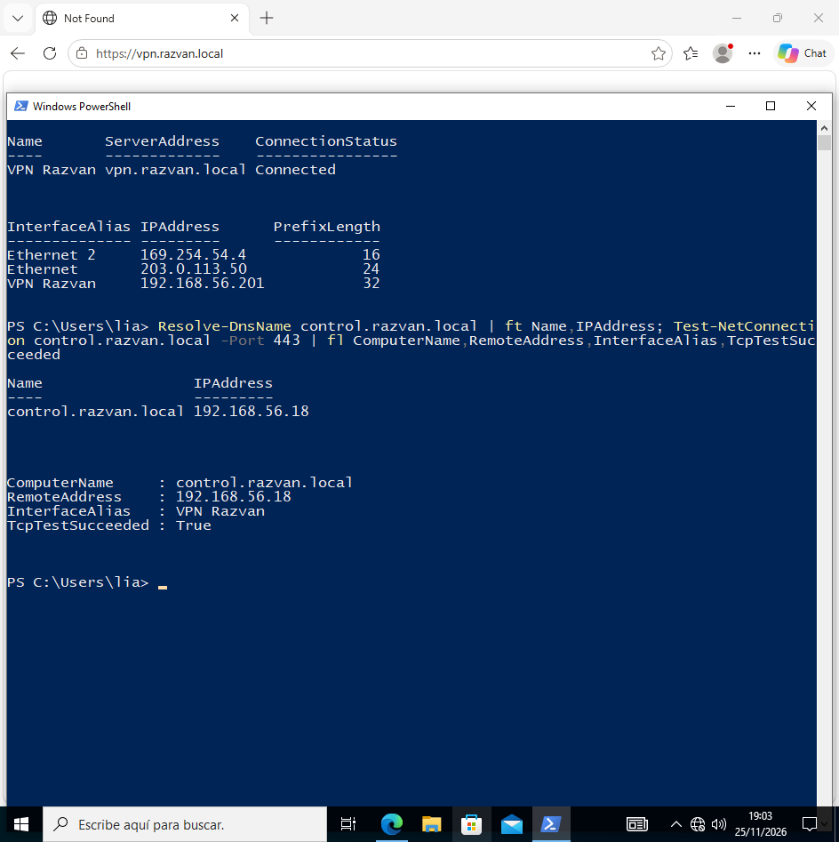

A Edge, `https://control.razvan.local` mostra el **Centre de control RAZVAN** amb el cadenat. La web viatja dins del túnel, des de l'oficina fins al sofà de la Lia.

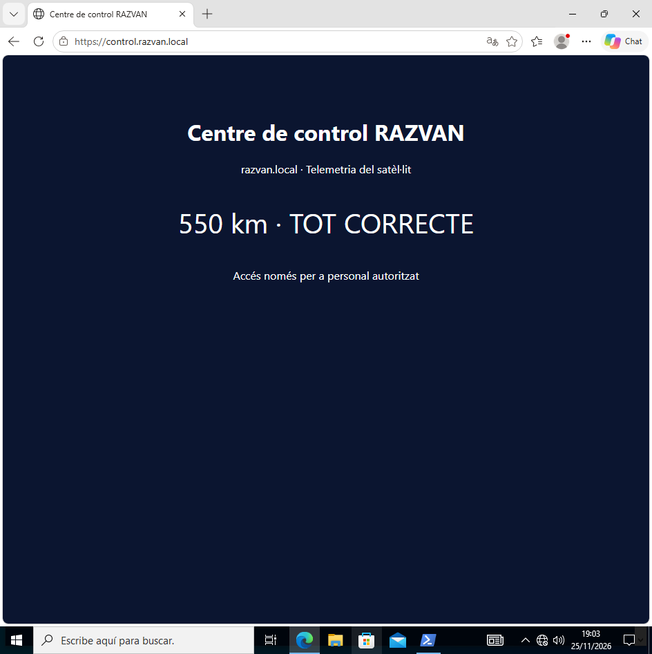

Al servidor, a **Clientes de acceso remoto**, es veu `RAZVAN\lia` connectada.

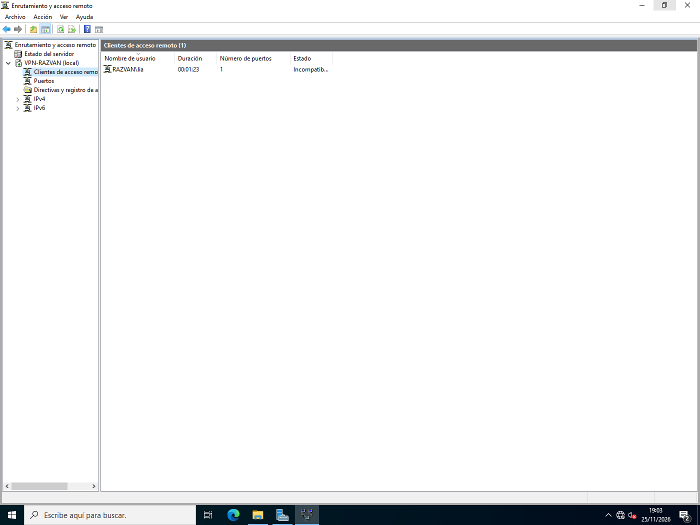

---

### Pas 27: El becari ho prova (Nivell 13, part E)

Desconnectem i tornem a connectar, ara amb l'usuari `teo`. El certificat del servidor és bo i la contrasenya d'en Teo també, però surt l'**error 812**: una directiva del servidor VPN ha impedit la connexió. En Teo no té permís a la pestanya **Marcado**.

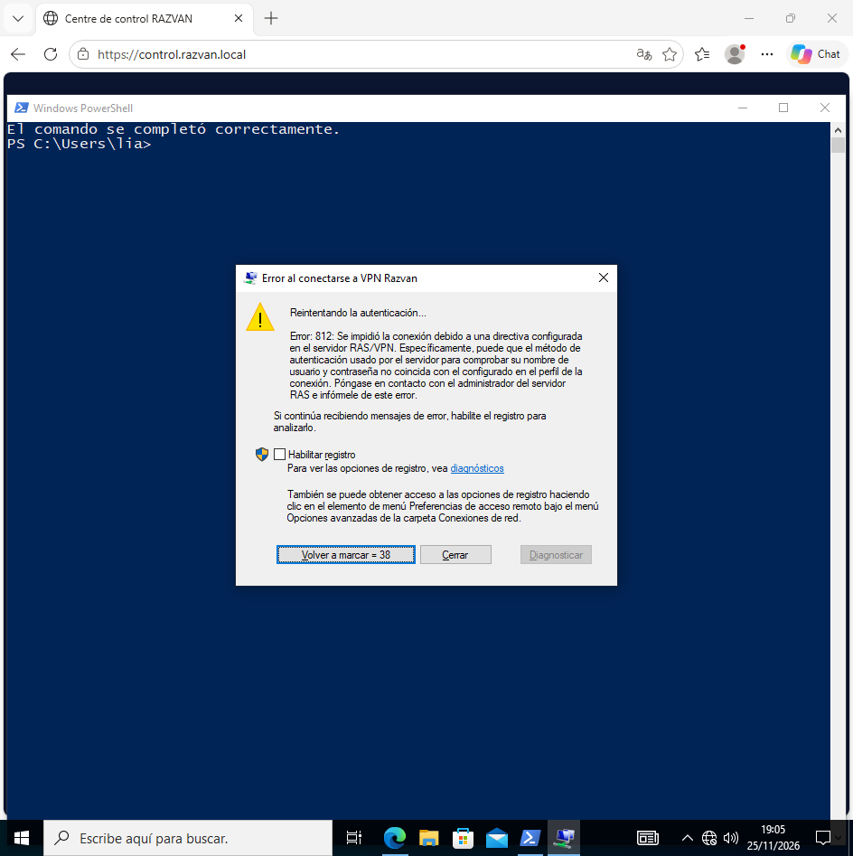

> **💡 Idea clau:** La VPN fa dues comprovacions. El client comprova el servidor amb el certificat `vpn.razvan.local`, signat per RAZVAN-CA. El servidor comprova l'usuari amb la contrasenya i el permís d'Active Directory. Sense el certificat, la Lia podria estar donant la contrasenya a un impostor.

#### Repte 13: El nom importa
Creem una segona connexió, **VPN per IP**, igual que la primera però amb l'adreça `203.0.113.1` en lloc del nom, i provem de connectar-nos amb la Lia.

```powershell
Add-VpnConnection -Name "VPN per IP" -ServerAddress 203.0.113.1 -TunnelType Sstp -AuthenticationMethod MSChapv2 -EncryptionLevel Required
rasdial "VPN per IP" lia * /domain:RAZVAN
```

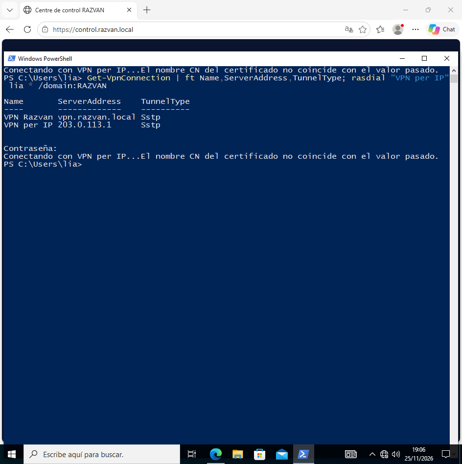

Falla amb **El nombre CN del certificado no coincide con el valor pasado**. És el mateix servidor i el mateix certificat, però el certificat diu `vpn.razvan.local` i al SAN no hi ha cap adreça IP. El client compara el nom al qual s'ha connectat amb el del certificat i, com que no coincideixen, no es fia del servidor. És el mateix que passava al Pas 8 de la 1a part quan entràvem a la web per `https://192.168.56.18` (`NET::ERR_CERT_COMMON_NAME_INVALID`).

Al final esborrem la connexió de prova i fem una instantània de les tres màquines (**VPN nivell 13**).
